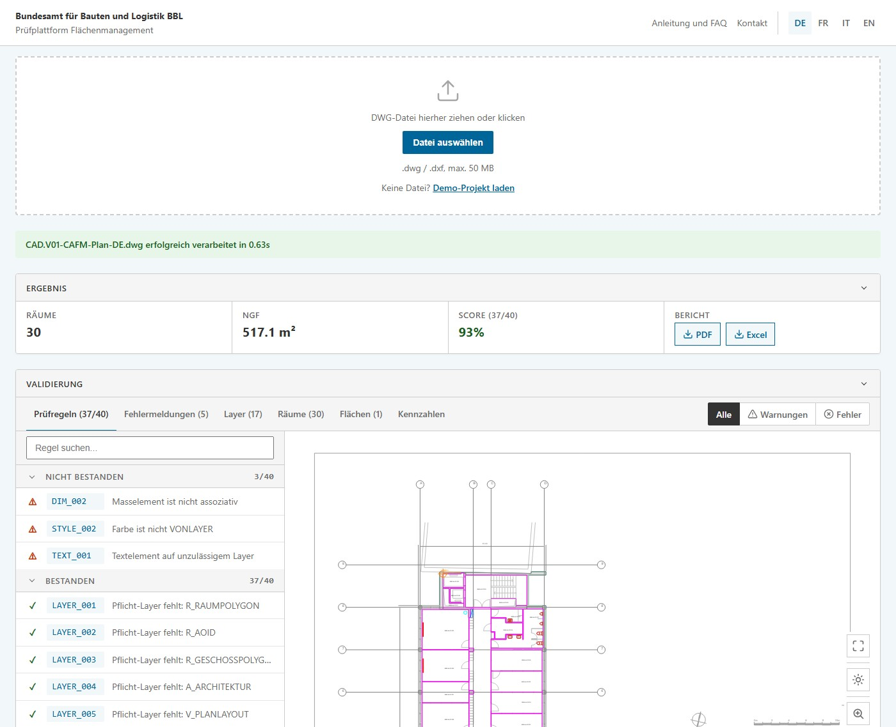
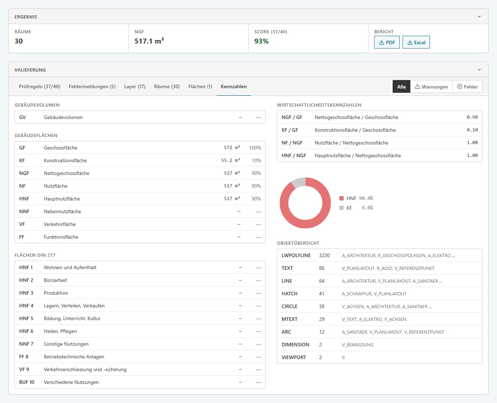

# Plan Checker / Prüfplattform Flächenmanagement

<p align="center">
  <a href="https://bbl-dres.github.io/plan-check/">
    
  </a>
</p>

[](https://bbl-dres.github.io/plan-check/)
[](LICENSE)

> [!CAUTION]
> Unofficial prototype for demonstration only. The sample data is fictional, validation is incomplete, and the tool is not a production approval service.

Browser-based prototype for checking DWG floor plans against selected BBL CAD and area-management rules.

## Demo

- **Plan viewer and checker:** https://bbl-dres.github.io/plan-check/
- **Project and access-management mockup:** https://bbl-dres.github.io/plan-check/prototype1/

<p align="center">
  
  
</p>

Files are processed locally in the browser and are not uploaded to a server.

## Features

- Parse DWG files in the browser (the bundled parser build has no DXF reader).
- Detect rooms and area polygons and apply configurable checks.
- Inspect plans with pan, zoom, selection, and issue highlighting.
- Review SIA 416 and DIN 277 area indicators.
- Export PDF and Excel validation reports.
- Open the prototype API reference from the same interface.
- Watch a short explainer film of the workflow on the landing page (German, French, Italian, English): export the DWG from your CAD or BIM program, upload it, fix the errors in your program, check again.

## Run locally

```bash
python -m http.server 8000
```

Open <http://localhost:8000/>.

### Explainer film

The film on the landing page is rendered from [media/how-it-works.html](media/how-it-works.html), a timeline page that can also be opened directly to review it (`?lang=de|fr|it|en`). Its interface texts are copied from `locales/*.json` on each render.

```bash
pip install playwright imageio-ffmpeg && python -m playwright install chromium
python media/render.py            # all four languages -> media/how-it-works-<lang>.webm and .jpg
```

## Documentation

- [User guide and FAQ (DE)](docs/anleitung-de.md)
- [Validation rules (DE)](docs/pruefregeln-de.md)
- [Terminology comparison](docs/terminologie-vergleich.md)
- [Prototype API reference](https://bbl-dres.github.io/plan-check/?view=api-docs)
- [Code review and refactoring notes](docs/code-review.md)

## License

[MIT License](LICENSE). The bundled LibreDWG runtime in [js/vendor/libredwg-web/](js/vendor/libredwg-web/) is licensed under GPL-3.0; see its [README](js/vendor/libredwg-web/README.md) and [LICENSE](js/vendor/libredwg-web/LICENSE). All bundled and CDN-loaded components are listed in [THIRD_PARTY.md](THIRD_PARTY.md).
